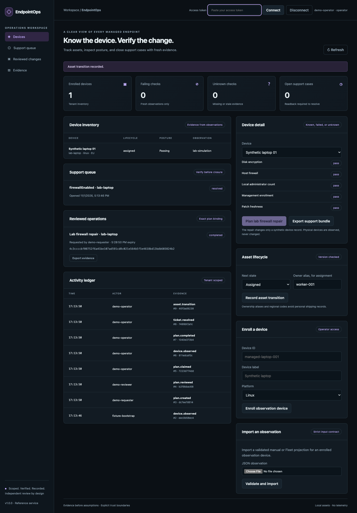
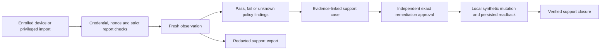

# EndpointOps

**Device posture, asset operations and support closure backed by fresh observations.**

Enroll tenant-scoped assets, collect bounded read-only observations, distinguish failures from unknown data, investigate support cases and require independent approval before a verified synthetic remediation. Includes a responsive workbench, credential-bound device ingestion, Fleet policy projection and privacy-conscious support export.

[](https://github.com/jayekwere/endpointops/actions/workflows/verify.yml) [MIT](LICENSE)



## Run it

```sh
git clone https://github.com/jayekwere/endpointops.git
cd endpointops
npm ci --ignore-scripts
npm run build
npm run demo
DEMO=1 npm start
```

Open **http://127.0.0.1:4420**. Connect the operator token printed by the server and inspect the synthetic laptop's failed firewall check. Trying to resolve its support case is denied. Connect the requester token to plan its lab repair, the reviewer token to approve, and the operator token to execute. A fresh persisted observation permits support closure. Export a redacted support bundle or record an asset assignment using an alias.

`docker compose up --build` runs a non-root, read-only local demo. `docker compose logs` shows disposable tokens; `docker compose down` stops it. Demo posture and remediation are explicitly synthetic. No physical endpoint setting is changed.

## Operational workflows

- **Inventory:** enroll Linux, macOS or Windows assets with a regional code and synthetic serial/owner aliases. Check lifecycle transitions and versions across received, assigned, in-transit, returned and retired states.
- **Posture:** evaluate encryption, firewall, patch age, administrator count and enrollment. Null, missing and stale evidence stays unknown rather than passing.
- **Device ingestion:** issue a random device credential once, store its hash, enforce tenant/device binding, timestamp and nonce checks, and support operator-driven rotation.
- **Support:** create a case for each failing or unknown check, prevent duplicate open cases, require fresh passing evidence before resolution and retain its fingerprint.
- **Reviewed remediation:** separate requester, reviewer and operator, bind the device/version/observation/policy, mutate only the local synthetic firewall state, and verify persisted readback in the same transaction.
- **Diagnostics:** collect OS release, uptime and free disk data with a fixed read-only collector. Optional operator-configured DNS/TCP/TLS diagnostics omit destination addresses from uploaded bundles.

## Real observations and integration scope

| Surface         | Implementation and acceptance                                                                                                                                                                                            |
| --------------- | ------------------------------------------------------------------------------------------------------------------------------------------------------------------------------------------------------------------------ |
| Local collector | Runs read-only Node OS/filesystem inspection; macOS uses two fixed bounded status commands for FileVault and firewall. Missing tools or authority yield unknown. Automated contract checked on the build host/container. |
| Device agent    | Real authenticated HTTP ingestion with a device-bound random bearer credential, replay checks, source/platform validation and strict projection. Automated and HTTP tests.                                               |
| Fleet           | Read-only pinned host GET with a separate credential and configured policy IDs. Contract tests validate projection and identity; no live Fleet server acceptance.                                                        |
| Manual imports  | Strict privileged import of supplied observations. They are operator assertions, not hardware attestation.                                                                                                               |
| Lab repair      | Actual persistent SQLite state transition and readback, always labeled local-simulation. It changes no physical firewall.                                                                                                |

This is not an MDM server and does not enroll devices through native management protocols, escrow recovery keys, encrypt disks, patch a workstation, ship equipment or execute remote scripts. Numeric patch/admin observations are not inferred from Fleet pass/fail policy results. The collector deliberately reports them unknown unless supplied through a supported observation. A compromised device holding its credential can fabricate telemetry; no TPM or hardware attestation is implemented.

## Collect and submit an observation

```sh
node --import tsx scripts/collect.ts local-observation
```

That command prints actual local readings. Keep them private. Public demo output validates the collector schema while omitting the workstation's readings. To submit from an enrolled observation device, set `DEVICE_ID`, `TENANT_ID`, `DEVICE_TOKEN` and `SERVER_URL` privately, then run:

```sh
node --import tsx scripts/agent.ts
```

Use HTTPS for configured remote servers. Loopback HTTP is permitted for a local lab. `PROBE_HOST` optionally enables bounded DNS/TCP/TLS diagnostics from that device. The destination is operator CLI configuration and never an API request field. It sends no application credentials to the diagnostic target. The API stores only allowed diagnostic states and durations, not the target name or returned addresses. See [integration details](docs/INTEGRATIONS.md).

## Reproduce validation

```sh
npm run verify
npm run coverage
npx playwright install chromium
npm run test:browser
docker build -t endpointops:local .
node scripts/container-smoke.mjs endpointops:local
```

The [asserted demo output](evidence/demo.json) records denied premature closure, verified lab repair, read-only replay, resolved ticket, five passing synthetic checks, collector-contract validation and audit integrity. Tests cover device-key isolation/rotation, nonce replay, stale reports, unsafe physical remediation, changed approvals, asset transitions, Fleet identity mismatch, persisted-readback rollback, token constraints and cross-tenant access. Browser tests exercise role separation, support export, asset assignment, hostile labels, credential clearing and responsive layout. [Validation evidence](evidence/VALIDATION.md) records actual results.



Configured mode uses the shared [authentication and deployment contract](docs/OPERATIONS.md). Optional `FLEET_CONFIG` names a read-only endpoint, tenant, fixed device/host bindings, policy IDs and an environment variable holding a dedicated credential. [The fixture](fixtures/fleet.example.json) is a shape example, not an operational account. Fleet is disabled in demo mode.

## Limits

Single process and local SQLite. Maximum 200 devices and 1,000 retained support cases per tenant. Nonces are bounded and old entries are pruned after their replay window. Device credentials require private storage and explicit rotation; they have no automatic expiry or managed hardware trust. Public demo tokens expire in fifteen minutes. The HMAC audit chain requires independently retained checkpoints for stronger rollback resistance. There is no native MDM remediation, remote shell, carrier/procurement integration, proof that a device's report is truthful, or claim that a passing projected policy establishes compliance.

[Architecture](docs/ARCHITECTURE.md) · [API](docs/API.md) · [Threat model](docs/THREAT-MODEL.md) · [Security reporting](SECURITY.md) · [MIT](LICENSE)
